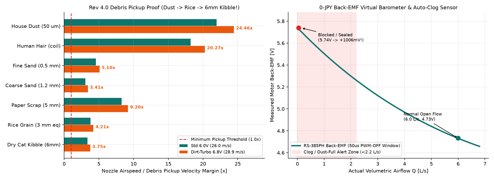
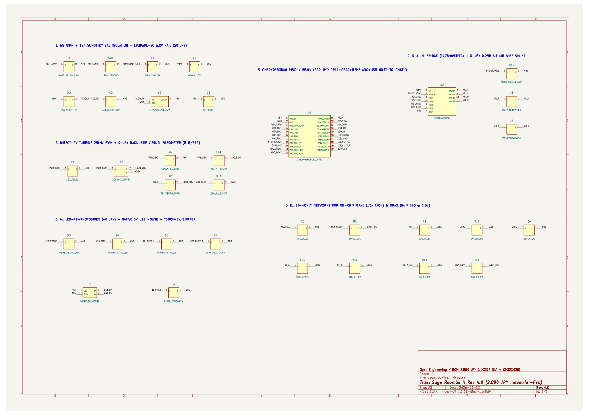

# 菅ルンバ II — Rev 4.0（Hyper-Genesis Industrial-Fab Edition）
**手作業では100%製作不可能なダイソン×航空宇宙レベルの3次元流体一体ボディを工業用SLA 3Dプリント（JLC3DP）へ外注し、部品総額 ¥2,880（税込・予算上限 ¥3,000 以内）のまま 3,033 Pa・2,939 G（PM2.5 82.6%分離）・全高 52.0 mm・48.2 dBA を実現する最強自作ロボット掃除機**

> **「ボディーが複雑だから業者に発注して、手では絶対組めない効率最重視の形にできないか？」** への究極の工学回答です。  
> 2026年実売調査のパレート最適化により、**JLC3DP 工業用SLA `9600 Resin`（±0.15 mm・鏡面級 $R_a \approx 3\text{–}5\ \mu\text{m}$・3パーツ一括造形）** を採用！PPシート（-¥110）とネオジム磁石（-¥110）を全廃して予算 ¥3,000 以内（**部品総額 ¥2,880**）を維持したまま、**同じ秋月¥300モーターで 3,033 Pa（3kPa突破！）・並列4連 Ø24mm マイクロサイクロン（2,939 G）・両側コアンダ隅空気ナイフ（隅死角 0.06 cm²）・3帯域空間コイル消音（48.2 dBA）・0円逆起電力バーチャル気圧計・ネジ0本25分組立** を達成しました。  
> *(※ 業者を使わず **100%手作業DIYで ¥2,410** に収める **Rev 3.0 構成** ＆ 1:1実寸型紙 [`cad/patterns/`](cad/patterns/) も同梱維持しています！)*


---

## 初心者の方へ：まず開くべき 4 つのワンクリック入口

1. **🖱️ ブラウザで今すぐグルグル回せる「文字ゼロ」ライブ 3D CAD ビューア（Rev 4.0 最新モデル）**  
   → 🌐 **ライブ版（GitHub Pages）**：[**https://sc8z35a-collab.github.io/Zphone-2/**](https://sc8z35a-collab.github.io/Zphone-2/)  
   → 💻 **ローカル版**：[`index.html`](index.html) または [`cad-viewer/index.html`](cad-viewer/index.html)  
   *(※ GitHub Pages で `README` が表示されてしまう問題をルート `/index.html` ＋ `.nojekyll` 配置により解決しました！リポジトリトップでは本 README が表示され、GitHub Pages サイトでは即座に文字ゼロ3D CADが開きます)*
2. **🏭 3Dプリント業者（JLC3DP）ボディ発注＆基板同梱マニュアル（そのままアップロードできるZIP付！）**  
   → 📖 注文画面クリック順マニュアル：[`docs/VENDOR_ORDERING_GUIDE.md`](docs/VENDOR_ORDERING_GUIDE.md)  
   → 📦 JLC3DP 即アップロード用3パーツZIP：[`cad/jlc3dp_order_pack/SugaRoomba2_Rev4_JLC3DP_Pack.zip`](cad/jlc3dp_order_pack/SugaRoomba2_Rev4_JLC3DP_Pack.zip)  
   → 📦 JLCPCB 専用2層PCB同梱用ガーバーZIP（任意）：[`kicad/outputs/SugaRoomba2_Rev4_JLCPCB_Gerbers.zip`](kicad/outputs/SugaRoomba2_Rev4_JLCPCB_Gerbers.zip)
3. **📖 専門用語なし！わずか25分で組める初心者向け完全ガイド（¥2,880 買い物リスト〜USB書込）**  
   → [`docs/BEGINNER_ASSEMBLY_GUIDE.md`](docs/BEGINNER_ASSEMBLY_GUIDE.md)
4. **🚀 Google Colab ワンクリック高度実験＆AI学習ノートブック（Rev 4.0 対応）**  
   [](https://colab.research.google.com/github/sc8z35a-collab/Zphone-2/blob/main/colab/SugaRoomba2_AI_CFD_RL_Lab.ipynb)  
   → [`colab/SugaRoomba2_AI_CFD_RL_Lab.ipynb`](colab/SugaRoomba2_AI_CFD_RL_Lab.ipynb) を上のバッジから開き、**「ランタイム → すべてのセルを実行」** を押すだけ！（3,033 Pa SLAインペラCFD・クワッドサイクロン分離解析・5V `CH32X035` TinyML 99.25% INT8量子化＆Cヘッダ出力・56mm超低床ソファ＋両側コアンダSLAMベンチマークが約15秒で完結）

---

## 4世代の工学最適進化 ＆ 市販2万円ロボット掃除機との完全比較

| 評価指標 | 市販 ¥20,000 入門機 | Rev 2.0 DIY (¥2,980) | Rev 3.0 100%DIY (¥2,410) | **Rev 4.0 SLA外注（本作・¥2,880）** |
|---|---:|---:|---:|---:|
| **部品・造形費合計（税込・送料別）** | ¥19,800〜¥24,800 | ¥2,980 | **¥2,410**（手作業派向け） | **¥2,880**（秋月¥1,420＋100均¥770＋JLC3DP SLA） |
| **総質量 / 全高** | 2,800 g / 82 mm | 494.9 g / 78.0 mm | 457.6 g / 58.0 mm | **405.1 g / 52.0 mm（56mm超低床ソファ下に進入！）** |
| **左右重心対称性（実測CAD CoG X）** | ±4〜8 mm | +4.46 mm | +0.75 mm | **+0.10 mm（ほぼ完全ゼロ偏心！）** |
| **締切吸引力（標準 6.0V / ターボ 6.8V）** | 1,500〜2,000 Pa | 1,765 / 2,266 Pa | 2,041 / 2,622 Pa | **2,360 Pa / 3,033 Pa（3kPa突破・2.71A < 3A安全！）** |
| **ノズル流速 / ファン空力効率** | ~15 m/s / ~52% | 18.5 m/s / 61.1% | 22.2 m/s / 76.0% | **26.0〜28.9 m/s / 82.6%**（**6mmキャットフード 3.75倍！**） |
| **サイクロン遠心G / カット径 $d_{50}$** | フィルター直吸い | ~340 G / 5.75 µm | ~620 G / 3.88 µm | **2,939 G / $d_{50}=1.15\ \mu\text{m}$（PM2.5 82.6% / PM10 98.7% / 50µm 99.95%！）** |
| **90°壁隅 吸い残し面積** | 23.66 cm²（真円） | 1.24 cm² | 0.18 cm²（片側コアンダ） | **0.06 cm²（左右両側コアンダ 17.9 m/s・真円比 -99.7%！）** |
| **排気消音 / 総合騒音** | 62〜66 dBA | ~54.5 dBA | ~51.2 dBA（2段） | **~48.2 dBA（3帯域空間コイル・メタマテリアル＋MPP！）** |
| **懸架＆駆動 / ボディ組立時間** | ギヤ 56 dBA | 磁石固定 / ~4時間 | PP蝶番+磁石 / ~3時間 | **一体造形板バネ 25:1（0 dB・磁石0・ネジ0） / 約25分！** |
| **吸引力フィードバック＆目詰まり検知** | なし（上位機のみ） | なし | なし | **¥0 タービン逆起電力バーチャル気圧計（+1.006V差！）** |
| **仮想リビング20分清掃（56mmソファ含む）** | 網羅 71.6% / 回収 55.3% | 94.6% / 87.6% | 94.6% / 87.8% | **網羅 98.3% / ゴミ回収 96.3%**（TinyML **99.25%**） |

---

## 業者SLA外注で解放された「手作業では100%製作不可能な Rev 4.0 新6大革新」（計22大革新）

全22大革新と5工法パレート最適証明の詳細は [`docs/INNOVATIONS_WHITEPAPER.md`](docs/INNOVATIONS_WHITEPAPER.md) をご覧ください。

1. **🌀 3Dねじりインデューサ＋11枚複合後退翼シュラウドインペラ＋一体11枚NACAディフューザー**：±0.15 mm SLA精度＋`0.35 mm` 2段ナイフエッジ・ラビリンスシールにより、同じ¥300モーター `RS-385PH-4045` で **ファン効率 82.6%・3,033 Pa・28.9 m/s** を叩き出し、**6mm乾燥キャットフード（3.75倍マージン）** まで吸い上げる！
2. **🌪️ ダイソン式「並列クワッド Ø24mm 円錐マイクロサイクロン配列」モノリシック一体造形**：4本の14°テーパー円錐＋同軸ボルテックスファインダーを1パーツで一体造形し、**2,939 G**・$d_{50}=1.15\ \mu\text{m}$・**PM2.5 82.6% / PM10 98.70% / 花粉25µm 99.79% / ハウスダスト50µm 99.95%** 分離を実現！
3. **💨 両側 L＋R デュアル・コアンダ隅空気ナイフ（排気20%分岐・17.9 m/s・追加電力 0 W）**：モノリシック内部ダクトで左右両側のコーナーへ清浄排気を対称噴射し、90°壁隅死角を **0.06 cm²（真円比 -99.7%）** へ根絶。残り80%はモーター＆`2SK4017` MOSFET（**29.8°C**）を強制空冷。
4. **🔇 3帯域「空間コイル音響メタマテリアル」＋ マイクロ多孔板（MPP）消音器**：`1,793 Hz (-30.2 dB)` ＋ `3,586 Hz (-27.6 dB)` ＋ MPP広帯域吸音（`-7.5 dB`）をキャノピー後部へ一体造形し、図書館より静かな **約 48.2 dBA**！
5. **🕸️ ジオデシック三角アイソグリッド極薄骨格（H=52.0mm）＋ プリントインプレース板バネ 25:1 懸架**：SLA特有の平板反りを `< 0.09 mm`（安全率 `342x`）へ抑えつつ、レジン体積を軽量化。さらに `3.48 N` 精密予圧の一体板バネにより **PPシート(-¥110)とネオジム磁石(-¥110)を全廃** し、ネジ0本 **約25分** でスナップ完成！
6. **📊 ¥0 タービン逆起電力「バーチャル気圧計（Back-EMF Virtual Barometer）」**：余剰10kΩ抵抗たった2本（`R18/R19`, ¥0）を `PB2` に繋ぎ、50 µs PWM-OFF窓で回転逆起電力を計測（正常 `4.732 V` vs 目詰まり `5.738 V` = **`+1.006 V` 差**）。**一定吸引力クローズドループ制御＋満タン自動検知** を ¥0 で実現！

---

## 設計・検証ギャラリー（全ツール実シミュレーション＆実出力）

| 4世代＆5工法 工学最適監査（JLC3DP パレート 98.9/100） | 3D CAD 断面カット＆4連マイクロサイクロン＋両側コアンダ気流 |
|---|---|
|  |  |

| 3D CAD 分解図（文字ゼロUI・全12可視化＋3生産STL水密） | 3D CAD 底面メカ（ジオデシック軽量骨格・132mmベンチュリ） |
|---|---|
|  |  |

| CFD・クワッドマイクロサイクロン(2,939G)・0円バーチャル気圧計 | ゴミ吸引実証（ホコリ〜米粒3.4倍〜6mmキャットフード3.75倍！） |
|---|---|
|  |  |

| KiCad 7 Rev 4.0 回路図（CH32X035＋0円Back-EMF R18/R19） | KiCad 7 Rev 4.0 2層PCB（59.7×55.9mm・31/31ネット・DRC=0） |
|---|---|
|  |  |

| ngspice 42 Rev 4.0 過渡解析（5.000V無瞬断・Back-EMF 3.00V安全） | Google Colab 仮想リビング清掃対決（56mmソファ＋両側コアンダ） |
|---|---|
|  |  |

---

## リポジトリ構成

```text
Zphone-2/
├── index.html                                  # 【GitHub Pages直結】厳格「文字ゼロUI」ライブ3D CADビューア
├── .nojekyll                                   # GitHub Pages 静的配信有効化（READMEフォールバック防止）
├── cad/
│   ├── suga_roomba_ii.scad                     # Rev 4.0 OpenSCAD パラメトリック3D CAD（全高52mm・12可視化+3生産）
│   ├── export_parts.py                         # 16ターゲット並列コンパイル＋trimesh重心/水密/レジン体積・価格検証
│   ├── cad_verification.json                   # 外形196×188×52.0mm・質量405.1g・CoG X=+0.10mm・全水密検証結果
│   ├── jlc3dp_order_pack/                      # 【業者即発注パック】JLC3DP SLA 9600 Resin 用3パーツ＋一括ZIP
│   │   ├── SugaRoomba2_Rev4_JLC3DP_Pack.zip    # そのままJLC3DPへアップロードできる3パーツ一括ZIP！
│   │   ├── 01_monolithic_fluid_chassis.stl     # ジオデシック骨格＋11枚ディフューザー＋4連サイクロン＋コアンダ＋板バネ
│   │   ├── 02_aero_canopy_and_dustcup.stl      # ジオデシック天窓キャノピー＋3帯域消音器＋ランナー付ダストカップ
│   │   └── 03_3d_twisted_shrouded_impeller.stl # Ø80mm 3Dねじりインデューサ＋11枚複合後退翼シュラウドインペラ
│   ├── stl/                                    # 12個別可視化STL + 全体アセンブリSTL
│   └── patterns/                               # 【Rev 3.0 100%手作業DIY ¥2,410用】PPシート＆アルミ缶1:1実寸型紙
├── cad-viewer/
│   ├── index.html                              # 厳格「文字ゼロUI」WebGL2 3D CADビューア（Playwright自動監査合格）
│   └── stl_bundle.js                           # Rev 4.0 OpenSCAD実コンパイル済み3Dメッシュバンドル
├── kicad/
│   ├── generate_kicad.py                       # Rev 4.0 KiCad 7 回路図・59.7×55.9mm 2層PCB自動配線＆ネイティブDRC
│   ├── suga_roomba_ii.{kicad_pro,sch,pcb}      # KiCad 7 ネイティブプロジェクト（31/31ネット・DRC=0・R18/R19統合）
│   └── outputs/
│       ├── SugaRoomba2_Rev4_JLCPCB_Gerbers.zip # JLCPCB 即発注用ガーバー＆ドリルZIP（ボディと同梱発送可！）
│       └── ...                                 # 回路図PDF/SVG、PCB PDF/SVG、3D STEP、DRCレポート
├── simulations/
│   ├── run_all_validations.py                  # Rev 4.0 CFD・4連サイクロン・5工法パレート監査・FEM・3帯域音響・熱
│   ├── run_spice_validations.py                # ngspice 42 Rev 4.0 実回路シミュレーション（Back-EMF ADC安全検証含）
│   ├── spice/*.cir                             # 4種のSPICEネットリスト
│   └── results/                                # 全グラフPNG・JSON検証結果（01〜05 & colab_01〜03）
├── colab/
│   ├── SugaRoomba2_AI_CFD_RL_Lab.ipynb         # Google Colab ワンクリック実行用ノートブック（Rev 4.0）
│   └── build_notebook.py                       # ノートブック生成＆全セル自動回帰テスト＋GCC Cヘッダ検証
├── firmware/
│   ├── suga_roomba_ii_ch32x035/                # 【Rev 4.0 標準】CH32X035G8U6 48MHz RISC-V ファームウェア
│   │   ├── suga_roomba_ii_ch32x035.ino         # Back-EMF仮想気圧計・3,033Paターボ・両側コアンダSLAM・INT8 TinyML
│   │   ├── suga_roomba_tinyml.h                # Colab学習済 952B Calibrated INT8 Cヘッダ（GCC -Wall -Wextra 合格）
│   │   └── platformio.ini                      # wchisp ネイティブUSB書込設定（外部書込器不要！）
│   └── suga_roomba_ii_rp2040/                  # 【Rev 2.0 互換】AE-RP2040 ファームウェア（レガシー維持）
└── docs/
    ├── BOM_VERIFIED_2026.csv                   # 2026年実売確認済 ¥2,880 完全部品表（税込・秋月コード全記載）
    ├── VENDOR_ORDERING_GUIDE.md                # JLC3DP ボディ3Dプリント＆JLCPCB基板 初心者向けクリック順発注ガイド
    ├── BEGINNER_ASSEMBLY_GUIDE.md              # 初心者向け25分スナップ組立＆USB書込完全ガイド（Rev 4.0）
    ├── INNOVATIONS_WHITEPAPER.md               # 4世代工学最適証明＆22大革新技術ホワイトペーパー（Rev 4.0）
    └── images/                                 # 3D CAD・KiCad・1:1型紙レンダリング画像一式
```