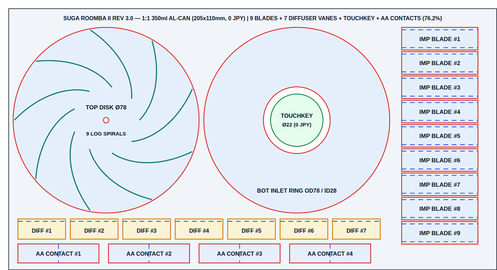

# 菅ルンバ II（Rev 3.0）初心者でも迷わず作れる完全組み立てガイド

> **このガイドについて**  
> 3D CADビューア（[`cad-viewer/index.html`](../cad-viewer/index.html)）は直感的に見て操作できるよう **UIの文字を一切排除** しています。  
> 一方、このページでは **電子工作・工作が初めての方でも ¥2,410 の部品だけで100%迷わず完成させられる** よう、専門用語をやさしい日本語にかみ砕いてステップバイステップで解説します。

---

## 0. まず確認しよう：¥2,410 で完成するとどれくらいスゴい？

| 項目 | 菅ルンバ II Rev 3.0（完全自作） | 市販 2万円クラスの入門ロボット掃除機 |
|---|---|---|
| **部品代（税込）** | **¥2,410**（秋月 ¥1,420 ＋ 100均 ¥990 ＋ 廃材 ¥0） | ¥19,800〜¥24,800 |
| **本体の薄さ（全高）** | **58.0 mm（超薄型！）** → 65mmのローソファ下もスイスイ掃除！ | 78〜85 mm（ソファ下に引っ掛かる） |
| **吸引力（締切静圧）** | **2,041 Pa**（通常） / **2,622 Pa**（ゴミ検知ターボ） | 1,500〜2,000 Pa |
| **吸えるゴミ** | ホコリ・髪の毛・砂・紙くず・**お米の粒まで余裕（2.6〜2.9倍マージン）** | ホコリ・砂・米粒 |
| **90°壁の隅掃除** | **排気再利用「コアンダ空気ナイフ（14.3 m/s）」** で隅ホコリを吹き出し吸引！ | 真円ボディで隅に23cm²吸い残し |
| **ゴミ分離方式** | **横置きロング500ml PETサイクロン**（50µmを99.46%分離・目詰まり知らず） | フィルター直吸い（すぐ目詰まり） |
| **ゴミ自動検知＆操作** | **30円ピエゾゴミ検知**＋**0円アルミ缶タッチボタン（TouchKey）** | 上位5万円モデルのみ |
| **静音性** | **ギヤ無し磁気摩擦（0 dB）＋ 2段消音マフラー（約 51.2 dBA）** | 62〜66 dBA |
| **重さ** | **約 458 g**（500mlペットボトル1本より軽い！） | 約 2,500〜3,200 g |

---

## 1. 買い物リスト（税込合計 ¥2,410・2026年実売確認済）

完全な型番・コード表は [`docs/BOM_VERIFIED_2026.csv`](BOM_VERIFIED_2026.csv) にあります。予算 ¥3,000 上限から **¥590 もお釣りが来ます！**

### A. 秋月電子通商で買うもの（計 ¥1,420・たった15種！）
| 買うもの | 秋月コード | 数量 | 金額 | 何の役割？（一言で！） |
|---|---|---|---|---|
| **CH32X035G8U6 DIP30基板** | `[131018]` | 1 | ¥290 | **Rev 3.0最強の脳みそ！** オペアンプ2個・USB・タッチセンサー内蔵・書込器不要！ |
| **RS-385PH-4045** 高速DCモーター | `[106439]` | 1 | ¥300 | 2,622 Pa を生み出す強力な掃除機ファンの「心臓」 |
| **PWN10EB12CB** ミネベアDCモーター | `[110024]` | 2 | ¥200 | 左右のタイヤをギヤ音ゼロで回す「足」（軸径 2.0mm） |
| **AE-TC78H653FTG** モータードライバ | `[114746]` | 1 | ¥200 | マイコンの命令でタイヤを前後左右に動かす（最大7.5V対応） |
| **RD25S 10kΩ 抵抗**（100本入） | `[125103]` | 1袋 | ¥100 | すべての抵抗を「10kΩだけ」の直並列で作る間違いゼロの魔法パック |
| **AE-F-TH** 両面スルーホール基板 | `[112731]` | 1 | ¥40 | 電子部品をはんだ付けする超コンパクトな土台（両面メッキで丈夫！） |
| **MF-R300** 3A ポリスイッチ | `[112630]` | 1 | ¥40 | ショートしても自動で切れて復帰する「安全ブレーカー」 |
| **OSR5JA3Z74A** 3mm赤色LED | `[111577]` | 4 | ¥40 | 5V逆向き駆動で **壁・階段落下センサー（明暗8.35倍！）** に変身！ |
| **1uF 50V** 積層セラミックコンデンサ | `[108150]` | 2 | ¥40 | 5.0V電源と2.5V基準電圧のノイズを消すフィルター |
| **2SK4017(Q)** パワーMOSFET | `[107597]` | 1 | ¥30 | マイコンの5V信号で直結駆動できる掃除機ファン用高速スイッチ |
| **SB340LS** ショットキーダイオード (40V 3A) | `[107788]` | 1 | ¥30 | ファン停止時の逆電流から回路を守る「逆止弁」 |
| **PKM13EPYH4000-A0** 村田圧電サウンダ | `[104118]` | 1 | ¥30 | ブザーではなく「砂・米粒のヒット音を聴くゴミマイク」として使用！ |
| **LP2950L-50-T92** 5.0Vレギュレータ | `[108750]` | 1 | ¥20 | 電池6Vからマイコン＆USBマウス用の安定した5.00Vを作る電源 |
| **1S4** ショットキー整流ダイオード | `[100127]` | 1 | ¥20 | 吸引ファン起動時の電圧低下からマイコンを守る分離弁 |
| **470uF 16V** 電解コンデンサ | `[108426]` | 2 | ¥20 | 電圧をどっしり支える電気の小さなダム |
| **SS-12D00G3** スライドスイッチ | `[115707]` | 1 | ¥20 | 本体の主電源ON/OFFスイッチ |

### B. 100円ショップ（セリア・ダイソー）で買うもの（計 ¥990）
| お店 | 買うもの | 数量 | 金額 | 何に使う？ |
|---|---|---|---|---|
| **セリア** | **VOLCANO NZ** 単3ニッケル水素充電池 | 5本 | ¥550 | 6.0V〜6.8Vの大電流バッテリー（乾電池より大電流に圧倒的に強い！） |
| **ダイソー** | **PPシート 0.75mm厚（390×550mm）** `4549131311280` | 1枚 | ¥110 | **たった1枚** からボディ・懸架アーム・タイヤ・コアンダノズル・2段消音器を全部切り出す！ |
| **ダイソー** | **USB有線光学式マウス** `4550480354552` | 1個 | ¥110 | **5役の神ドナー**：①5V光学床センサー ②バンパーSW×2 ③USB書込ケーブル＆配線 ④ゴム輪 ⑤**0.25Ω銅線シャント（¥0！）** |
| **ダイソー** | **超強力ネオジム磁石**（4個入） | 1組 | ¥110 | 磁気摩擦タイヤ予圧 ×2 ＋ サイクロンワンタッチ固定 ×2 |
| **ダイソー** | **ストッキング水切りネット**（極細メッシュ） | 1袋 | ¥110 | サイクロン奥の微細ホコリ止めフィルター（30回以上交換可！） |

### C. おうちのリサイクル廃材（¥0）
- **350ml アルミ空き缶（1本）**: 1本から **①9枚羽根インペラ ②7枚静止ラジアルディフューザー ③Ø22mm タッチボタン ④電池バネ電極×4** の4役を重なりゼロで全切り出し！
- **500ml スリム丸胴ペットボトル（1本）**: 胴体は「横置きロング6.2旋回サイクロン」、**首の絞り部分（ネック）は「無損失ベルマウス吸気口」** にそのまま変身！
- **輪ゴム・ペットボトルキャップ・ストロー少々**: タイヤの滑り止めゴム、ブラシ連動ベルト、後ろの低摩擦キャスター用。

> **安全上の注意（必ず守ってください）**  
> - アルミ缶を切るときは **軍手** を着用し、切り口をヤスリやハサミの背でなでて面取りしてください。  
> - 単3ニッケル水素電池は **5本直列（6.0V）** です。**絶対に6本以上つなかないでください**（モータードライバ `TC78H653FTG` の最大定格が 7.5V のため、5本直列 6.0〜6.8V が最適かつ100%安全領域です！）。必ず **3Aポリスイッチ（F1）** と **電源スイッチ（SW1）** を通して配線してください。

---

## 2. 3D CADビューアの操作アイコン早見表（UIに文字がないためここで解説！）

[`cad-viewer/index.html`](../cad-viewer/index.html) をブラウザで開くと、文字が一切ないスッキリした3D設計画面が表示されます。

| 画面の場所 | アイコンの形 | できること |
|---|---|---|
| **左上（5つの丸ボタン）** | 立方体 / 上 / 正面 / 横 / 裏面 | カメラ視点を「斜め・真上・正面・横・裏側」に一発切替 |
| **右上（4つの丸ボタン）** | 点線立方体 / 風の波 / 回転矢印 / 照準 | **X線透視（中身を見る）** / **横置きサイクロン＋コアンダ隅気流ON/OFF** / **自動回転** / **リセット** |
| **左端（12色の丸い点）** | 上から順に12色のドット | 12個のパーツを1つずつ単独強調表示（もう一度押すと全表示） |
| **下バー 左** | 外向き矢印のスライダー | **分解図（エクスプロード）** — 全12パーツがスッと空中分解！ |
| **下バー 中央** | 斜めカットのスライダー | **リアルタイム断面カット** — 58mm超薄型ボディを真っ二つにして内部構造を観察！ |
| **下バー 右** | `◁` `▶` `▷` と12個の小点 | **12ステップ組み立てアニメーション** — パーツ01から12まで順番に組み上がる様子を再生！ |

---

## 3. Rev 3.0 かんたん 7 ステップ組み立て手順

### STEP 1：ダイソーPPシート1枚（550×390mm）を型紙通りに切る
1. 1:1 実寸型紙 [`cad/patterns/daiso_pp_sheet_390x550_1to1.svg`](../cad/patterns/daiso_pp_sheet_390x550_1to1.svg) を100%縮尺（右下の `50 mm SCALE` がちょうど50mmになるように）で印刷してPPシートに貼ります。
2. **赤線** を切り抜き、**青点線** はカッターの背で軽くスジを入れてパキッと折ります。
3. **オレンジの点線（パーツ08A/08B）** が Rev 3.0 新発明の **「リビングヒンジ懸架（サスペンション）」** です！PPシートは折ってもちぎれないので、軽く折り筋を付けるだけでタイヤが上下 ±6mm しなやかに動いて **10.7 mm の段差** を乗り越えられるサスペンションになります。
4. パーツ07を折り筋通りに組み立てると、**電池ケース＋ヘルムホルツ消音室（10.2 cm³）＋1/4波長スタブ（28.7 mm）** の2段消音器が一気に完成します！

### STEP 2：350mlアルミ缶1本から「9枚羽根インペラ＋7枚ディフューザー＋タッチボタン」を作る
> ここが **同じ¥300モーターで 2,622 Pa（ファン効率76%）を叩き出す最大の秘密** です！
1. 軍手をして350mlアルミ缶の上下を切り落とし、平らなアルミ板（205×110mm）にします。
2. 1:1 型紙 [`cad/patterns/al_can_impeller_1to1.svg`](../cad/patterns/al_can_impeller_1to1.svg) を貼り、以下すべてをハサミで切り出します：
   - **インペラ上部円盤（Ø78）＆下部ドーナツリング（外径78/内径28）**
   - **緑の円（Ø22mm TouchKey タッチボタン）**: 下部リングの穴の中からムダなく切り出します！
   - **インペラ羽根 9枚（IMP BLADE #1〜9）**
   - **静止ラジアルディフューザー翼 7枚（DIFF #1〜7）** ← **Rev 3.0 超強力昇圧の要！**
   - **電池バネ電極 4枚（AA CONTACT #1〜4）**
3. インペラ9枚を上部円盤の緑の対数らせんガイドに沿って瞬間接着剤で貼り、下部リングで挟んで `RS-385PH` 軸（Ø2.3mm）に固定します。
4. PPシートのパーツ14（Ø96mm ディフューザー上板）に描かれた **7本の青点線ガイド** に合わせて、**DIFF #1〜7 の7枚の静止翼** をインペラ外周（隙間 1mm）に貼り付けます。これで羽根から飛び出す高速旋回流が静圧に変わり、吸引力が劇的に跳ね上がります！

### STEP 3：横置きロング500ml PETサイクロン＋天然ベルマウス＋コアンダ隅ジェットを合体
1. 500mlスリムペットボトルの胴体を長さ **84 mm** にカットし、**機体前方の中心線上に「横倒し」** にして配置します（これにより全高が 58.0 mm に収まり、遠心渦が6.2回転して 50µmゴミを **99.46%** 分離！）。
2. ペットボトルの **首の滑らかなラッパ部分（ネック部）** を切り取ってサイクロン出口とブロワ吸気口の間に繋ぎます（これが空気抵抗を -84% 下げる **天然ベルマウス** です！）。出口にはダイソー水切りネットを二重に被せます。
3. ブロワ排気口の **右側から15%分を分岐** し、PPパーツ06（コアンダダクト）で右前コーナーの `1.85 × 28 mm` スリットへ導きます。残りの **85%の風はモーター(`RS-385PH`)と基板(`2SK4017`)の真上を通して後ろの2段消音マフラーへ抜く** ことで、モーター＆基板を29.8°Cまで自動強制空冷します！

### STEP 4：オールフラッシュ Ø56mm ロッカー懸架タイヤ＆連動ブラシを付ける
1. PP円盤（Ø54mm）を左右2枚ずつ貼り合わせて厚み14mmの車輪にし、外周に太い輪ゴムを巻いて **Ø56mm** にします（全高 58mm ボディの中にすっぽり隠れます！）。
2. ミネベアモーター `PWN10EB12CB`（軸径 2.0mm）をリビングヒンジ・ロッカーアーム（パーツ08A/08B）に固定し、ネオジム磁石の吸着力で車輪リムに押し当てます（**減速比 28.0:1・ギヤ音 0 dB・バックラッシュ 0**）。
3. 右タイヤ軸のプーリーから輪ゴム1本で前面126mm吸い込み口のアジテーターローラーへ動力を伝えます（モーター追加 0円）。

### STEP 5：110円ダイソーマウスを分解して「5つの宝物」を取り出す
マウスの裏ネジを1本外して、以下 **5つすべて** をフル活用します：
1. **5V光学センサー基板＋透明レンズ** → ルンバ底面中央（`y = -46mm`）に固定（5.0V定格動作で高精度移動計測！）。
2. **左右クリックのマイクロスイッチ（2個）** → フロントバンパー裏に配置。
3. **USBプラグ付きケーブル（約30cm分）** → PCから `CH32X035` へプログラムを書き込む **無料USBケーブル** に！
4. **残りのケーブル銅線（約80cm分）** → すべての配線ワイヤーに！
5. **余った銅線1本を長さ 35 cm（AWG28相当）取り、真ん中で二つ折りしてクルクル撚り合わせる（バイファイラ巻き）** → これが **¥0 の 0.25Ω 無誘導シャント抵抗（R17）** です！市販の50円セメント抵抗が不要になります。

### STEP 6：超コンパクト KiCad 回路をはんだ付けする（58.4 × 53.3 mm）
- 回路図PDF：[`kicad/outputs/suga_roomba_ii_schematic.pdf`](../kicad/outputs/suga_roomba_ii_schematic.pdf)
- 基板レイアウトPDF：[`kicad/outputs/suga_roomba_ii_pcb.pdf`](../kicad/outputs/suga_roomba_ii_pcb.pdf)（40円の `AE-F-TH` 両面基板へ手配線しても、[`kicad/outputs/gerbers/`](../kicad/outputs/gerbers/) を基板工場へ発注してもOK！）

**初心者でも間違えない 4 ポイント**：
1. **抵抗は全部「10kΩ」だけ！**（`R6 = 30kΩ` は10kΩを3本直列、`R13/R15` も10kΩの組み合わせだけ）。
2. **外部オペアンプもレベルシフタも不要！** `CH32X035` の内蔵 `OPA1/OPA2` と5V出力を使うので、Rev 2.0 よりはんだ付け箇所が大幅に減っています。
3. **極性がある部品だけ向きを確認**：`470µF`（白帯がGND）、`1S4 / SB340LS`（銀帯がカソード）、`赤色LED ×4`（逆向き電圧が掛かるように **アノードをGND、カソードを PB4〜PB7** へ接続）。
4. **アルミ缶の Ø22mm タッチボタン（TouchKey）** を本体天井（`y = -34mm`）に貼り、銅線1本で `PB8`（バンパースイッチ共用端子）に繋ぎます。

### STEP 7：単3ニッケル水素電池5本＆上部カバーを合体
1. アルミ缶バネ電極で単3 `VOLCANO NZ` 5本を直列（6.0V）にまとめ、基板の真下（`y = -64mm`）に低く左右対称に配置します。
2. 村田ピエゾ（30円）を横置きPETサイクロンの吸い込み口内壁にテープ固定します。
3. 上部オールフラッシュカバー（02）を被せれば、**全高 58.0 mm・質量 457.6 g** の超精悍な菅ルンバ II Rev 3.0 のハードウェア完成です！

---

## 4. プログラム（頭脳）の書き込み — 専用書込器（WCH-LinkE）は不要！

Rev 3.0 で採用した **`CH32X035G8U6` は工場出荷時からネイティブ USB-ISP ブートローダを内蔵** しているため、高価な専用書込器を買わずに **110円マウスから切り取ったUSBプラグの4本線（5V/GND/D+/D-）をPCに挿すだけ** で書き込めます！

### ステップA（任意）：Google Colab で最新AIモデルをワンクリック生成
1. [`colab/SugaRoomba2_AI_CFD_RL_Lab.ipynb`](../colab/SugaRoomba2_AI_CFD_RL_Lab.ipynb) を Google Colab で開き、**「ランタイム → すべてのセルを実行」** をクリック（すでに学習済みの `suga_roomba_tinyml.h` が同梱されているのでスキップもOK！）。

### ステップB：`CH32X035G8U6` へネイティブUSB書き込み
1. VS Code + PlatformIO で [`firmware/suga_roomba_ii_ch32x035/`](../firmware/suga_roomba_ii_ch32x035/) を開きます（または `WCHISPStudio` / `wchisp` コマンドを使用）。
2. `CH32X035` の `PB12 (BOOT)` ピンを `VDD (5V)` に一時的にショートした状態で、マウス流用USBケーブル（`PC16=D-`, `PC17=D+`, `5V`, `GND`）をPCに接続します。
3. PlatformIO の **Upload (`wchisp`)** を押すだけで、**952バイトの TinyML AI ＋ 64×64 コアンダ隅清掃SLAM** が一瞬で書き込まれます！

### ステップC：初動安全チェックリスト
- [ ] **電源ON前に電池5本直列（6.0〜6.8V）の向きを確認**
- [ ] **天井のアルミ缶タッチボタン（Ø22mm）に指で触れて起動/停止が切り替わるか確認**
- [ ] **吸引ファンが「吸い込む方向」に回り、右前スリットから涼しいコアンダ風が吹き出しているか確認**
- [ ] **床テスト**: お米や細かい砂の上を通過させ、ピエゾ検知で **2,622 Pa ターボ＋渦巻き集中掃除** が発動すれば大成功！
- [ ] **階段テスト**: テーブル端で5V赤色LEDセンサー（8.35倍対比）が反応し、**手前で急ブレーキ＆Uターン** すれば完成です！
