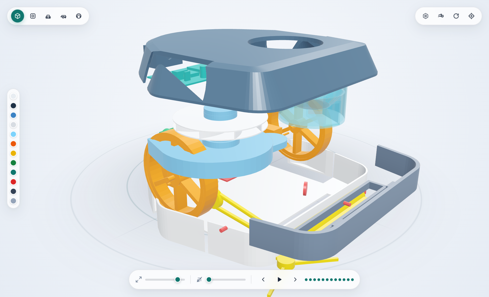
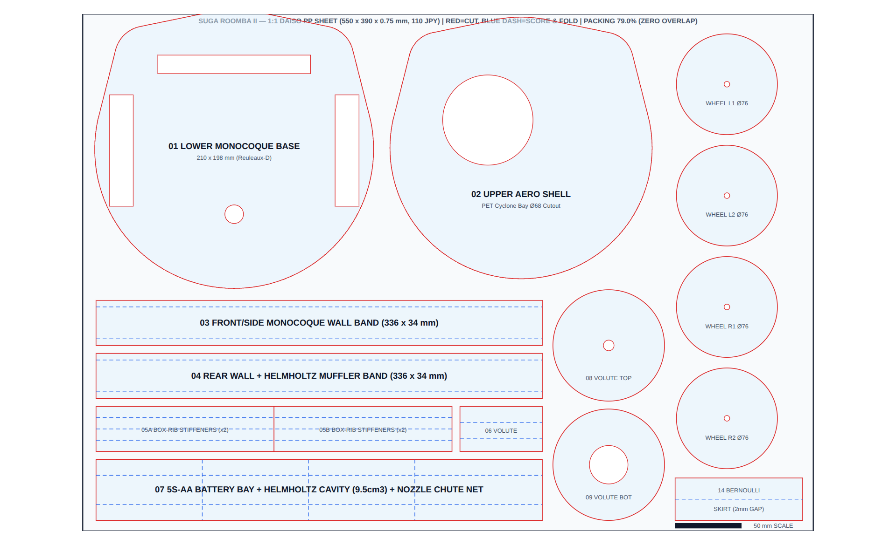
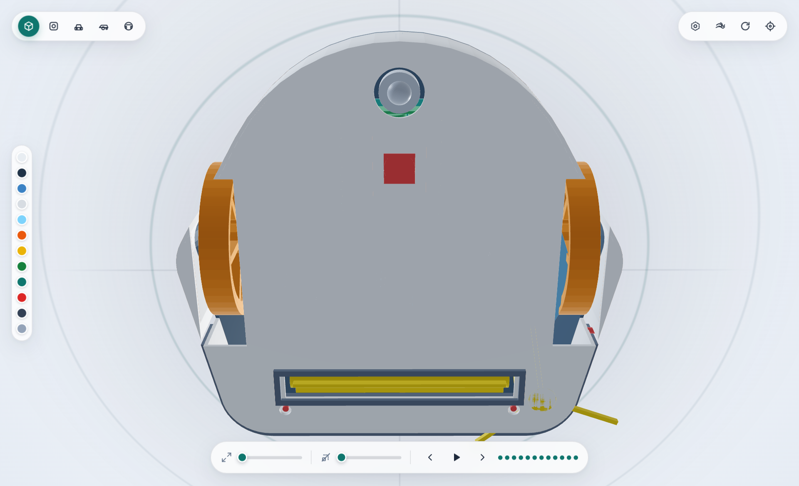
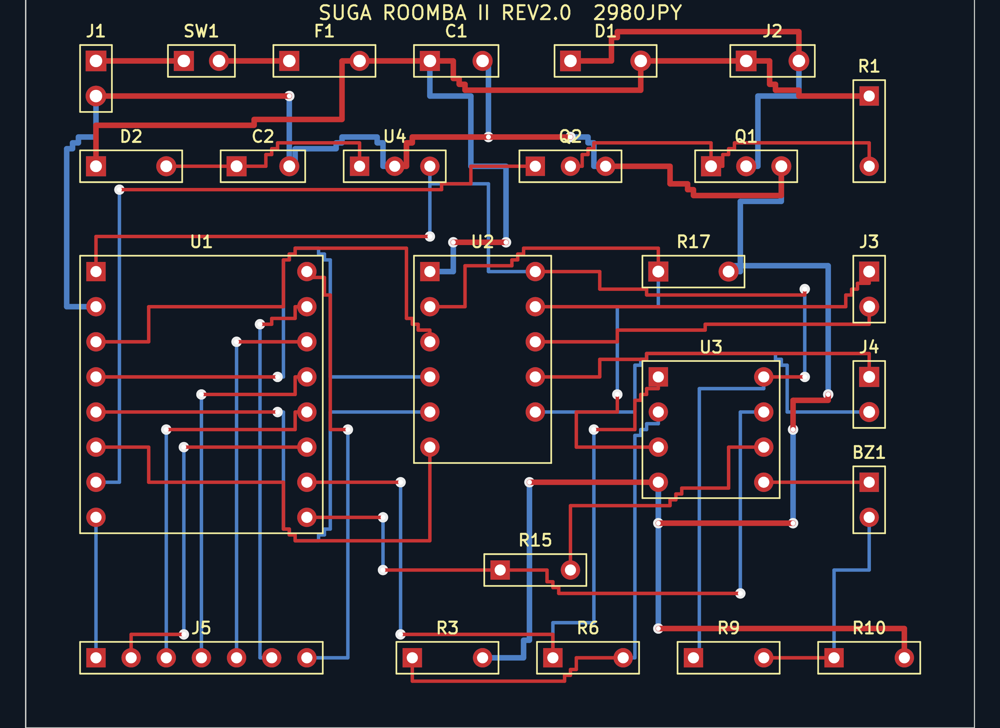

# 菅ルンバ II（Suga Roomba II）初心者でも迷わず作れる完全組み立てガイド

> **このガイドについて**  
> 3D CADビューア（[`cad-viewer/index.html`](../cad-viewer/index.html)）は直感的に見て操作できるよう **UIの文字を一切排除** しています。  
> 一方、このページでは **電子工作・機械工作が初めての方でも100%迷わず完成させられる** よう、専門用語をやさしい日本語にかみ砕いてステップバイステップで解説します。

---

## 0. まず確認しよう：完成するとどれくらいスゴい？

| 項目 | 菅ルンバ II（自作） | 市販 2万円クラスの入門ロボット掃除機 |
|---|---|---|
| **部品代（税込）** | **¥2,980**（秋月電子＋100均＋空き缶＆ペットボトル） | ¥19,800〜¥24,800 |
| **吸引力（締切静圧）** | **1,685 Pa**（通常） / **2,177 Pa**（ゴミ検知ターボ） | 1,500〜2,000 Pa |
| **吸えるゴミ** | ホコリ・髪の毛・砂・紙くず・**お米の粒まで実証済** | ホコリ・砂・米粒 |
| **ゴミ分離方式** | **500mlペットボトル製 本格サイクロン**（目詰まりしにくい） | フィルター直吸い（目詰まりしやすい） |
| **ゴミの自動検知** | **あり（30円ピエゾ素子）** → 砂や米粒が多い場所で自動ターボ＆渦巻き掃除 | なし（上位5万円モデルのみ） |
| **階段落下防止＆壁検知** | **あり（40円の赤色LEDを光センサー化）** | 赤外線モジュール（高価） |
| **静音性・ギヤ音** | **ギヤ無し磁気摩擦駆動（ギヤ音0dB）＋共鳴消音マフラー（-15dB）** | 樹脂ギヤのウィーン音 |
| **重さ** | **約 495 g**（市販の約 1/6 の超軽量！） | 約 2,500〜3,200 g |

---

## 1. 買い物リスト（税込合計 ¥2,980・2026年実売確認済）

完全な型番・商品コード表は [`docs/BOM_VERIFIED_2026.csv`](BOM_VERIFIED_2026.csv) にあります。お店ごとに3カ所に分けて揃えます。

### A. 秋月電子通商で買うもの（計 ¥1,990）
| 買うもの | 秋月コード | 数量 | 金額 | 何の役割？（一言で！） |
|---|---|---|---|---|
| **AE-RP2040** マイコンボード | `[117542]` | 1 | ¥700 | ルンバの「脳みそ」（デュアルコアAI搭載） |
| **RS-385PH-4045** 高速DCモーター | `[106439]` | 1 | ¥300 | 強力な掃除機ファンを回す「心臓」 |
| **PWN10EB12CB** ミネベアDCモーター | `[110024]` | 2 | ¥200 | 左右のタイヤを静かに回す「足」 |
| **AE-TC78H653FTG** モータードライバ | `[114746]` | 1 | ¥200 | マイコンの命令でタイヤを前後左右に動かす |
| **RD25S 10kΩ 抵抗**（100本入） | `[125103]` | 1袋 | ¥100 | 回路のすべての抵抗を「10kΩだけ」の組み合わせで作る魔法パック |
| **MCP6002-E/P** デュアルオペアンプ | `[130011]` | 1 | ¥80 | 電流の波（車輪速度）とピエゾ（ゴミ音）を増幅する「耳」 |
| **MPC74 0.33Ω 5W** セメント抵抗 | `[110699]` | 1 | ¥50 | タイヤの力加減と壁ぶつかりを感じ取る「触覚」 |
| **AE-DB1** 片面ユニバーサル基板（Dタイプ） | `[108242]` | 1 | ¥50 | 電子部品をはんだ付けしてまとめる「土台」 |
| **MF-R300** 3A ポリスイッチ（復帰ヒューズ） | `[112630]` | 1 | ¥40 | 間違えてショートしても火事にならない「安全ブレーカー」 |
| **2SK4017(Q)** パワーMOSFET | `[107597]` | 1 | ¥30 | 掃除機モーターのON/OFF・強弱を切り替える高速スイッチ |
| **SB340LS** ショットキーダイオード (40V 3A) | `[107788]` | 1 | ¥30 | モーター停止時の逆電流から回路を守る「逆止弁」 |
| **LP2950L-33-T92** 3.3Vレギュレータ | `[108749]` | 1 | ¥30 | 電池6Vからマイコン用のきれいな3.3Vを作る電源 |
| **PKM13EPYH4000-A0** 村田圧電サウンダ | `[104118]` | 1 | ¥30 | ブザーではなく「超敏感ゴミ衝突マイク」として使う！ |
| **OSR5JA3Z74A** 3mm赤色LED | `[111577]` | 4 | ¥40 | 光らせるだけでなく「壁・階段センサー」に変身させる！ |
| **1uF 50V** 積層セラミックコンデンサ | `[108150]` | 2 | ¥40 | 電気のノイズを消すフィルター |
| **1S4** 整流ダイオード | `[100127]` | 1 | ¥20 | 吸引モーターの電圧低下からマイコンを守る分離弁 |
| **470uF 16V** 電解コンデンサ | `[108426]` | 2 | ¥20 | 一時的に電気を貯めておく小さなダム |
| **SS-12D00G3** スライドスイッチ | `[115707]` | 1 | ¥20 | 本体の主電源スイッチ |
| **DTC114EL** デジタルトランジスタ | `[112467]` | 1 | ¥10 | 3.3V信号で6VパワーMOSFETを確実に駆動する中継役 |

### B. 100円ショップ（セリア・ダイソー）で買うもの（計 ¥990）
| お店 | 買うもの | 数量 | 金額 | 何に使う？ |
|---|---|---|---|---|
| **セリア** | **VOLCANO NZ** 単3充電池（ニッケル水素） | 5本 | ¥550 | 6.0V〜6.8Vの大電流バッテリー（乾電池より大電流に超強い！） |
| **ダイソー** | **PPシート 0.75mm厚（390×550mm）** `4549131311280` | 1枚 | ¥110 | **たった1枚** からボディ・カバー・タイヤ・消音器を全部切り出す！ |
| **ダイソー** | **USB有線光学式マウス** `4550480354552` | 1個 | ¥110 | **4役の神ドナー**：①床移動センサー ②バンパースイッチ×2 ③1.2m配線ケーブル ④ゴム輪 |
| **ダイソー** | **超強力ネオジム磁石**（4個入） | 1組 | ¥110 | タイヤ駆動の磁気バネ ×2 ＋ ゴミ箱ワンタッチ固定 ×2 |
| **ダイソー** | **ストッキング水切りネット**（極細メッシュ） | 1袋 | ¥110 | サイクロン奥の微細ホコリ止めフィルター（数十回交換可能！） |

### C. おうちのリサイクル廃材（¥0）
- **350ml アルミ空き缶（1本）**: 超軽量・高剛性の「9枚羽根 遠心インペラ」と「電池ケースのバネ電極」を作ります。
- **500ml 炭酸用ペットボトル（丸胴・1本）**: 透明で中が見える「本格デュアルサイクロン集塵機」になります。
- **輪ゴム（太め数本）・ペットボトルキャップ・ストロー少々**: タイヤの滑り止めゴム＆ブラシ連動ベルト用。

> **安全上の注意（必ず読んでください）**  
> - アルミ缶を切るときは切り口が鋭利です。**軍手（または作業手袋）** を着用し、切った端はヤスリやハサミの背でなでて面取りしてください。  
> - 単3ニッケル水素電池は **5本直列（6.0V）** にします。プラスとマイナスを直接つなぐ（ショートする）と発熱します。必ず **3Aポリスイッチ（F1）** と **電源スイッチ（SW1）** を通して配線してください。

---

## 2. 3D CADビューアの操作アイコン早見表（UIに文字がないためここで解説！）

[`cad-viewer/index.html`](../cad-viewer/index.html) をブラウザで開くと、文字が一切ないスッキリした3D設計画面が表示されます。

| 画面の場所 | アイコンの形 | できること |
|---|---|---|
| **左上（5つの丸ボタン）** | 立方体 / 上から見た丸 / 正面 / 横 / 裏面 | カメラ視点を「斜め3D・真上・正面・横・裏側（タイヤと吸い込み口）」に一発切替 |
| **右上（4つの丸ボタン）** | 点線立方体 / 風の波 / 回転矢印 / 照準 | **X線透視（中身を見る）** / **サイクロン気流アニメーションON/OFF** / **自動回転** / **初期位置リセット** |
| **左端（12色の丸い点）** | 上から順に12色のドット | 12個のパーツを1つずつ強調・単独表示（もう一度押すと全表示に戻る） |
| **下バー 左** | 外向き矢印のスライダー | **分解図（エクスプロード）** — すべての部品がスッと空中分解して構造が一目瞭然！ |
| **下バー 中央** | 斜めカットのスライダー | **リアルタイム断面カット** — 本体を真っ二つにスライスして羽根やサイクロン内部を観察！ |
| **下バー 右** | `◁` `▶` `▷` と12個の小点 | **12ステップ組み立て再生** — パーツ01から12まで順番に組み上がるアニメーションを再生！ |

---

## 3. 12ステップかんたん組み立て手順

### STEP 1：ダイソーPPシート1枚（390×550mm）を型紙通りに切る（パーツ01・02・06）
1. 1:1 実寸型紙 [`cad/patterns/daiso_pp_sheet_390x550_1to1.svg`](../cad/patterns/daiso_pp_sheet_390x550_1to1.svg) を100%縮尺（右下の `50 mm SCALE` が定規でちょうど50mmになるように）で印刷し、ダイソーPPシートにマスキングテープで貼ります。
2. **赤線** をカッターまたは工作バサミで切り抜きます。
3. **青の点線** に定規を当て、カッターの**背（刃のない側）** で軽くなぞって折り筋（スジ入れ）を付けます。すると厚紙のようにパキッと直角に折れます！
4. 下部シャーシ（01）の内側に「箱リブ（05A/05B）」を直角に折ってホットボンドまたはPP用接着剤で貼ると、ペラペラだったシートが **約18,500倍の硬さ** になり、2.5kgのダンベルを載せてもビクともしないモノコック構造になります。

### STEP 2：350mlアルミ缶から「最強9枚羽根インペラ」を作る（パーツ04）
> ここが **吸引力を2万円クラスにする最大の秘訣** です！
1. 軍手をしてアルミ缶の上下を切り落とし、平らなアルミ板（205×110mm）にします。
2. 1:1 型紙 [`cad/patterns/al_can_impeller_1to1.svg`](../cad/patterns/al_can_impeller_1to1.svg) を貼り、**上部円盤（Ø78mm）**・**下部ドーナツリング（外径78mm/内径28mm）**・**羽根9枚（幅9.6mm×長さ31mm）** をハサミで切り出します。
3. 各羽根の青点線（上下1.2mm幅）を90°折り曲げて「のりしろ」にし、指でゆるやかにカーブさせます。
4. 上部円盤の **緑の対数らせんガイド線** に合わせて9枚の羽根を瞬間接着剤（ゼリー状）で固定し、上から下部ドーナツリングをかぶせて接着します。
5. 中心の穴（Ø2.3mm）に `RS-385PH` モーターの軸を差し込み、ペットボトルのキャップ中央を小さく切ったハブで補強して瞬間接着剤でブレなく固定します。

### STEP 3：カタツムリ型ボリュート＆500ml PETサイクロンを作る（パーツ03・05）
1. **ボリュート（送風機ケース）**: PPシートのパーツ08・09（Ø84mm円盤）と帯（06）で、インペラを包むカタツムリ型のケースを作ります。インペラ外周との隙間は **2〜3mm** が理想です。
2. **500mlペットボトル・サイクロン**: 丸胴の500mlペットボトルを高さ約50mmにカットし、側面ギリギリ接線方向に長方形（14×24mm）の吸い込み口を開けます（空気が壁に沿って猛スピードでグルグル回るようにするため！）。
3. サイクロン中央の天井から直径28mmの筒（ボーテックスファインダー）を半分ほど垂らし、出口に **ダイソーの水切りネットを二重** にして輪ゴムで被せます。
4. 底フタにはダイソーのネオジム磁石を2個貼り、ゴミ捨てがワンタッチでできるようにします。

### STEP 4：ギヤなし「磁気摩擦タイヤ駆動」と連動ブラシを付ける（パーツ06・07・12）
1. PPシートの車輪円盤（Ø76mm）を左右2枚ずつ貼り合わせて厚み14mmのホイールを作り、外周に **太い輪ゴムを2〜3重** に巻いて滑り止めタイヤ（Ø78mm）にします。
2. ミネベアモーター `PWN10EB12CB`（100円）をPPの短いスイングアームに固定し、モーターの金属軸（Ø2.4mm）を **車輪の内側リムにネオジム磁石の吸着力でピタッと押し当てます**。これで **ギヤ無し・騒音ゼロ・減速比 32.5:1** の超精密駆動が完成！
3. 右タイヤの軸に小さなプーリー（ペットボトルの蓋を加工）を付け、輪ゴム1本で前方の吸い込み口ローラーブラシとコーナー用サイドブラシに動力を伝えます（モーター追加 0円！）。
4. 後方中央（`y = -82mm`）に滑りの良いペットボトルの丸底やビー玉/樹脂ドームを貼り、後輪キャスター（パーツ12）にします。

### STEP 5：110円ダイソーマウスを分解して「4つの宝物」を取り出す（パーツ10・11）
1. ダイソー有線マウスの裏のネジを1本外して開けます。
2. 中から次の4つをすべて再利用します：
   - **① 光学センサー基板＋透明レンズ** → ルンバ裏側中央の穴（`y = -48mm`）に固定（床の模様を読んで移動距離を正確に測定！）。
   - **② 左右クリックのマイクロスイッチ（2個）** → フロントバンパーの裏に配置（壁に軽く触れただけで反応）。
   - **③ USBケーブル（1.2m・4芯）** → すべての配線ワイヤーとして切り分けて使用（配線代 0円！）。
   - **④ スクロールホイールのゴムリング** → 連動ベルトの滑り止めに活用。

### STEP 6：電子回路をはんだ付けする（パーツ09・KiCad図面完備）
- 回路図全体：[`kicad/outputs/suga_roomba_ii_schematic.pdf`](../kicad/outputs/suga_roomba_ii_schematic.pdf)
- 基板レイアウト：[`kicad/outputs/suga_roomba_ii_pcb.pdf`](../kicad/outputs/suga_roomba_ii_pcb.pdf)（ガーバーデータも [`kicad/outputs/gerbers/`](../kicad/outputs/gerbers/) にあるので、基板製造サービスにそのまま発注しても、50円の `AE-DB1` ユニバーサル基板に手配線してもOK！）

**初心者向けはんだ付けのコツ（たった3ポイント）**：
1. **抵抗は全部「10kΩ」だけ！**  
   買い間違いが絶対に起きません。例えば 30kΩ が欲しい場所は 10kΩ を3本直列、3.3kΩ が欲しい場所は 10kΩ を3本並列につなぐだけ（E1単一抵抗ネットワーク技術）。
2. **電源分離（1S4ダイオード＋470µFコンデンサ）を忘れずに**  
   吸引モーター起動時に電池電圧が一瞬 4.4V まで下がっても、マイコン（RP2040）の3.3Vが絶対に落ちないように守ってくれます。
3. **極性（向き）がある部品だけ注意！**  
   - 電解コンデンサ（470µF）：白い帯がある側がマイナス（GND）。
   - ダイオード（1S4・SB340LS）：銀色の帯がある側がカソード（矢印の先）。
   - 赤色LED（4個）：短い足がアノード/カソードを確認し、**逆向き電圧を掛ける** 配線（アノードをGND、カソードをGP14〜17）にします。

### STEP 7：単3ニッケル水素電池5本＆上部カバー＋消音マフラーを合体（パーツ02・08）
1. アルミ缶から切り出したバネ電極を使い、単3充電池（VOLCANO NZ）5本を直列（6.0V）にまとめて、**車軸の少し後ろ（`y = -46mm`）** に低く配置します。これにより重心が安定し、タイヤに **約91%の荷重** が乗って段差（最大9.7mm）をグイグイ登れます！
2. 村田ピエゾ素子（30円）をサイクロンの吸い込み口の内壁にテープで貼ります（ゴミが当たるとコツコツ音が電気信号になります）。
3. 最後に上部カバー（02）を被せ、後ろの排気口横に9.5 cm³ の小部屋（ヘルムホルツ共鳴マフラー）を貼り付ければハードウェア完成！

---

## 4. プログラム（頭脳）の書き込みとテスト運転

### ステップA：Google ColabでAIをワンクリック学習（任意・すでに学習済ファイル同梱！）
1. [`colab/SugaRoomba2_AI_CFD_RL_Lab.ipynb`](../colab/SugaRoomba2_AI_CFD_RL_Lab.ipynb) を Google Colab にアップロードします。
2. 上部メニューの **「ランタイム」→「すべてのセルを実行」** をワンクリック！
3. 約15秒で CFD最適化・TinyML学習・仮想リビング対決グラフが表示され、最新のAI重みファイル `suga_roomba_tinyml.h` が自動ダウンロードされます。

### ステップB：RP2040へ書き込み
1. Arduino IDE（ボードマネージャで `Raspberry Pi Pico/RP2040` by Earle Philhower を追加）または PlatformIO で [`firmware/suga_roomba_ii_rp2040/suga_roomba_ii.ino`](../firmware/suga_roomba_ii_rp2040/suga_roomba_ii.ino) を開きます。
2. `AE-RP2040` の BOOTSEL ボタンを押しながらPCにUSB-C接続し、「書き込み」をクリック。

### ステップC：初動チェックリスト（安全確認）
- [ ] **電源ON前に電池の向きを確認**（5本直列で 6.0〜6.8V）
- [ ] **吸引ファンが「吸い込む方向」に回るか確認**（ティッシュをノズルに近づけてピタッと吸い付くこと！逆ならモーター配線の＋−を入れ替え）
- [ ] **タイヤを手で浮かせて前進確認**（左右どちらかが逆回転ならそのモーターの2線を入れ替え）
- [ ] **床テスト**: 塩やお米を少し撒いた上を通過させ、ピエゾが反応して **ターボ音＋その場渦巻き掃除** が発動すれば大成功！
- [ ] **階段テスト**: テーブルの端に向かってゆっくり走らせ、赤色LEDセンサーが反応して **手前で急ブレーキ＆Uターン** することを確認！
